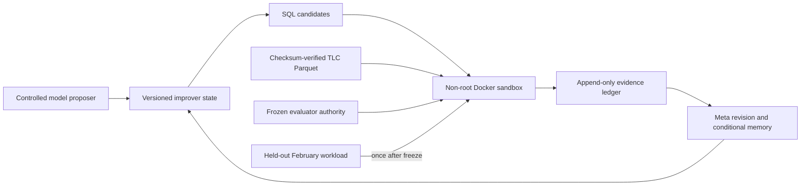

# Architecture

The proposer cannot read the repository, raw data or protected evaluator. Evaluated SQL runs with no network, a read-only filesystem, fixed CPU/memory/time budgets and an allowlisted SQL grammar. The host verifies authority hashes before every container run. Development and selection tasks drive search; held-out tasks are mounted only for the single final evaluation of a frozen run.
